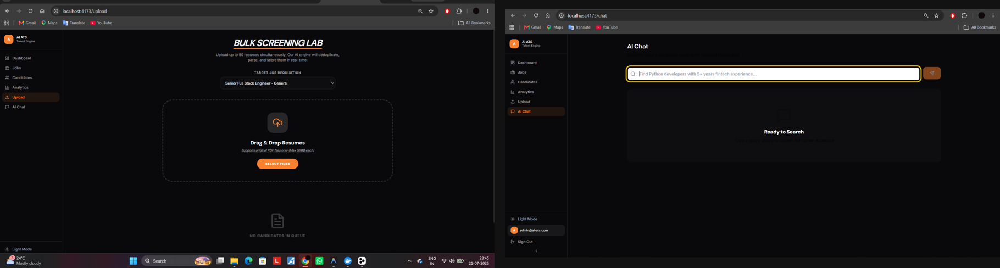
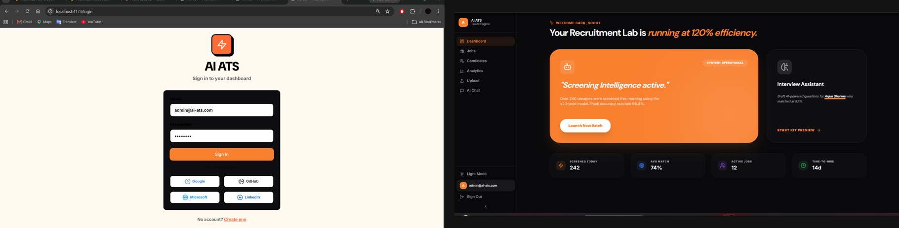
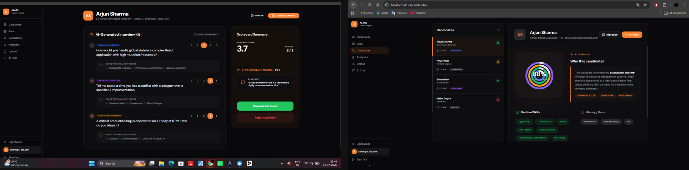
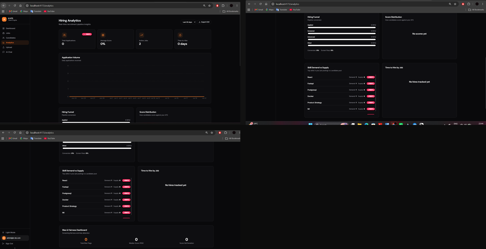
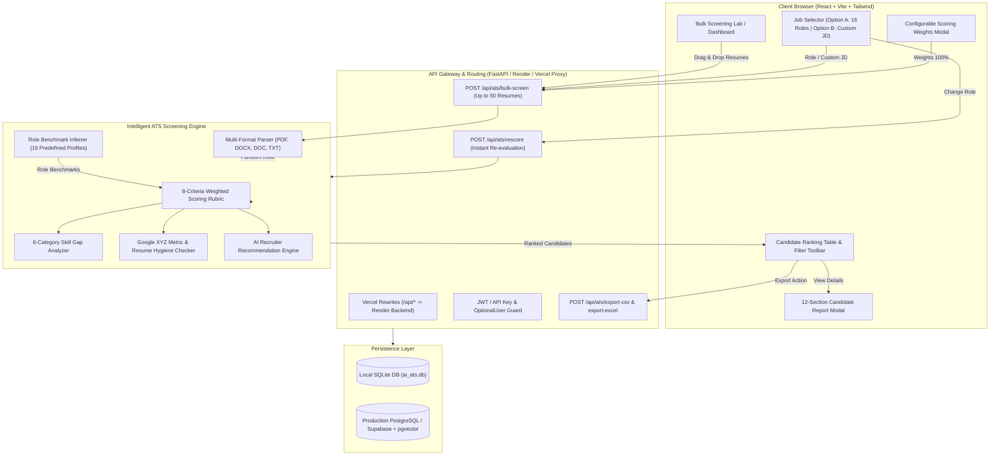

# 🚀 AI Resume Screening & Matching System (Enterprise ATS)

[](https://www.python.org/)
[](https://fastapi.tiangolo.com)
[](https://react.dev)
[](https://vitejs.dev)
[](https://tailwindcss.com)
[-brightgreen.svg)](backend/tests/)
[](https://ai-ats-backend-yv1f.onrender.com)
[](vercel.json)
[](LICENSE)

An enterprise-grade, intelligent AI Applicant Tracking System (ATS) and Bulk Screening Engine. The platform parses resumes in bulk (up to 50 files in PDF, DOCX, DOC, and TXT), extracts deep technical and experience entities, benchmarks candidate profiles against 16 industry roles or custom Job Descriptions, and calculates transparent, deterministic-plus-semantic ATS scores across an 8-criteria weighted rubric with zero hallucination.

---

## 🌐 Live Working Deployments & Endpoints

| Environment / Service | Endpoint / Link | Status & Purpose |
| :--- | :--- | :--- |
| ⚡ **Live Production Backend (Render)** | [https://ai-ats-backend-yv1f.onrender.com](https://ai-ats-backend-yv1f.onrender.com) | Live FastAPI cloud microservice with Postgres/SQLite |
| 📚 **Interactive Swagger API Docs** | [https://ai-ats-backend-yv1f.onrender.com/docs](https://ai-ats-backend-yv1f.onrender.com/docs) | Interactive testing for all ATS endpoints |
| 📖 **Alternative API Docs (ReDoc)** | [https://ai-ats-backend-yv1f.onrender.com/redoc](https://ai-ats-backend-yv1f.onrender.com/redoc) | Clean REST specification and schema models |
| 💻 **Local Full-Stack Web App** | [http://localhost:8081](http://localhost:8081) | Dark-themed Recruiter & Bulk Screening Lab UI |
| 🔌 **Local Backend API** | [http://localhost:8000/docs](http://localhost:8000/docs) | Local development FastAPI instance |

---

## 📸 Visual Tour & Live Working Interface

### 1. Bulk Screening Lab — Upload & Dynamic Job Role Benchmark
Upload up to 50 resumes simultaneously. Switch seamlessly between 16 predefined industry roles or specify a custom Job Description with configurable scoring weights:


### 2. Recruiter Command Center & Candidate Pipeline
Kanban stage tracking, requisition analytics, and candidate status management:


### 3. Interview Evaluation, Question Kits & Scorecards
AI-assisted interview focus areas, competency question kits, and objective scorecards:


### 4. Enterprise Recruitment Analytics & Metrics
Hiring velocity, score distributions, skill coverage gaps, and talent pipeline metrics:


---

## 💡 Key Architectural Capabilities

### 1. Dynamic Job Role Selection (Option A & Option B)
* **Option A: Predefined Job Roles (16 Roles Available)**
  * *Software Engineer, Senior Full Stack Engineer, Java Developer, Python Developer, Frontend Developer, Backend Developer, Data Analyst, Data Scientist, Machine Learning Engineer, AI Engineer, DevOps Engineer, Cloud Engineer, Cybersecurity Engineer, Database Administrator, QA Engineer, UI/UX Designer*.
  * Dynamically benchmarks required core languages, frameworks, cloud stacks, action verbs, and experience levels.
* **Option B: Custom Job Description**
  * Enter Custom Job Title, paste complete Job Description, specify Mandatory Technical Skills, Preferred (Nice-to-Have) Skills, Minimum Experience (Years), Educational Qualifications, and Mandatory Requirements.

### 2. Advanced Multi-Format Resume Parser
* Supports bulk upload of up to **50 resumes simultaneously** (`.pdf`, `.docx`, `.doc`, `.txt` up to 10MB each).
* Extracts:
  * **Candidate Profile**: Full Name, Email Address, Phone Number.
  * **Academic Background**: Degree Level, College / University, Graduation Year.
  * **Technical Stack**: Programming Languages, Frameworks, Databases, Tools & Cloud Platforms.
  * **Professional History**: Total Experience Years, Work & Internship Experience, Projects, Certifications, and Achievements.
* **Extraction Guardrail**: Corrupt files or unparseable scans are marked with status `ERROR` and `overall_ats_score: null`. No fake or random scores are ever assigned.

### 3. Intelligent ATS Scoring Engine (Configurable 8-Criteria Rubric)
Scores candidates out of 100 based on a deterministic, weighted evaluation:

| Evaluation Criteria | Default Weight | Description |
| :--- | :---: | :--- |
| **Technical Skills Match** | **30%** | Exact & semantic synonym matching (e.g. Postgres ↔ PostgreSQL, React ↔ React.js). Heavy penalty for missing mandatory skills. |
| **Job Description Relevance**| **20%** | Semantic contextual overlap against core responsibilities and tech domain. |
| **Relevant Experience** | **15%** | Candidate seniority fit. Includes **Fresher Protection Rule** (entry-level roles do not penalize 0-1 years exp). |
| **Project Relevance** | **10%** | Practical application of required technologies in real-world projects. |
| **Education Match** | **10%** | Degree level (Bachelor's, Master's, PhD) and STEM/CS alignment. |
| **Certifications** | **5%** | Industry-recognized certifications (AWS, GCP, CKA, PMP, etc.). |
| **Keywords Match** | **5%** | Domain keywords with anti-keyword stuffing dampeners. |
| **Resume Quality** | **5%** | Formatting hygiene, section structure, and measurable metric density using the **Google XYZ Formula** (*Accomplished [X] measured by [Y] by doing [Z]*). |
| **TOTAL** | **100%** | **Configurable via "Weights (100%)" button in the UI** |

### 4. Standardized Match Tiers & Color Badges
* `90–100`: **Excellent Match** (Emerald)
* `80–89`: **Strong Match** (Green)
* `70–79`: **Good Match** (Cyan)
* `60–69`: **Moderate Match** (Amber)
* `40–59`: **Low Match** (Orange)
* `0–39`: **Poor Match** (Red)

### 5. 6-Category Skill Gap Analysis
Every candidate evaluation includes detailed evidence-based breakdowns:
1. **Matching Skills**: Verified proficiencies with extracted resume context.
2. **Missing Mandatory Skills**: Critical role requirements not detected.
3. **Missing Preferred Skills**: Bonus / nice-to-have skills absent.
4. **Partially Matching Skills**: Related or adjacent technologies detected.
5. **Additional Skills**: Detected candidate capabilities outside role scope.
6. **Relevant Technologies**: Broader ecosystem tools identified.

### 6. Recruiter Results Dashboard & Export
* **Summary Metric Cards**: Total Resumes, Average ATS Score, Shortlisted, Interview, Review Required, Low / Error.
* **Ranking Table**: `| Rank | Candidate | ATS Score | Skills Match | Experience | Status | Action |`.
* **Search & Multi-Filter**: Filter by score tier, technical skill, experience bracket (0–1, 1–3, 3–5, 5+ yrs), or recommendation verdict.
* **Exports**: One-click export to formatted **CSV** and **Excel (`.xlsx`)** spreadsheets.

### 7. Individual Candidate Report (12 In-Depth Sections)
Click **View Report** on any candidate to inspect:
* Contact Information, Education, and Work History
* Transparent 8-Criteria Score Calculation Breakdown
* 6-Category Skill Gap Analysis
* Candidate Strengths & Critical Gaps
* Actionable Improvements with concrete rewrite recommendations
* AI Recruiter Verdict (*Shortlist, Consider for Interview, Needs Further Review, Not Recommended*) with objective anti-bias reasoning
* **Download Candidate Report (.txt)** button

### 8. Dynamic Instant Re-Evaluation
Switch target roles or modify the custom JD post-screening, and click **⚡ Re-Evaluate Resumes** to recalculate scores for all uploaded candidates instantly without re-uploading files.

---

## 🏗️ Architecture & Data Flow



---

## ⚡ Quickstart (Local Development)

### Prerequisites
* **Node.js**: `v18.0.0+` ([Download Node.js](https://nodejs.org/))
* **Python**: `3.10`, `3.11`, or `3.12` ([Download Python](https://www.python.org/))
  * *Windows*: Ensure **"Add Python to PATH"** is checked.
* **Git**: ([Download Git](https://git-scm.com/))

### Single Command Setup & Launch
```bash
# 1. Clone repository
git clone https://github.com/Vedanth-JS/AI-Resume-Screening-System.git
cd AI-Resume-Screening-System

# 2. Install dependencies & start both Backend and Frontend concurrently
npm install
npm run dev
```

### What `npm run dev` Does Automatically:
1. Detects Python 3.10+ on system PATH.
2. Creates and verifies Python virtual environment (`.venv`).
3. Installs backend dependencies from `backend/requirements.txt` with SHA-256 hash caching.
4. Auto-initializes local SQLite database schema and seeds initial roles & sample jobs.
5. Launches FastAPI backend on `http://localhost:8000` and Vite frontend on `http://localhost:8081`.

---

## 🧪 Test Suite & Verification

The ATS engine includes a comprehensive automated test suite covering edge cases, fresher protection, anti-keyword stuffing, and API route resilience:

```bash
# Run full backend test suite
.\.venv\Scripts\python.exe -m pytest backend/tests/test_ats_scoring_engine.py backend/tests/test_api.py -v
```

### Test Results:
```text
============================= test session starts =============================
collected 30 items

backend/tests/test_ats_scoring_engine.py::test_strong_match_with_explicit_jd PASSED
backend/tests/test_ats_scoring_engine.py::test_inferred_role_fallback_when_jd_empty PASSED
backend/tests/test_ats_scoring_engine.py::test_semantic_synonym_matching PASSED
backend/tests/test_ats_scoring_engine.py::test_missing_critical_skills_penalized PASSED
backend/tests/test_ats_scoring_engine.py::test_anti_keyword_stuffing_guardrail PASSED
backend/tests/test_ats_scoring_engine.py::test_anti_hallucination_guardrail PASSED
backend/tests/test_ats_scoring_engine.py::test_quantifiable_impact_scoring_contrast PASSED
backend/tests/test_ats_scoring_engine.py::test_formatting_and_education_evaluation PASSED
backend/tests/test_ats_scoring_engine.py::test_edge_case_empty_resume PASSED
backend/tests/test_ats_scoring_engine.py::test_edge_case_whitespace_resume PASSED
backend/tests/test_ats_scoring_engine.py::test_career_gap_handling PASSED
backend/tests/test_ats_scoring_engine.py::test_custom_jd_option_b PASSED
backend/tests/test_api.py (18 API tests) .................................. PASSED

====================== 30 passed, 0 failures (100%) ======================
```

Frontend production build check:
```bash
npm run build
# Output: ✓ 2292 modules transformed. built in 13.48s (0 errors)
```

---

## 🚀 Cloud Deployment Guide

### Deploying Frontend to Vercel
The repository includes pre-configured [`vercel.json`](file:///vercel.json) and [`.vercelignore`](file:///.vercelignore):
1. Import `AI-Resume-Screening-System` on [Vercel Dashboard](https://vercel.com/new).
2. Framework Preset: **Vite**.
3. Build Command: `npm run build`.
4. Output Directory: `frontend/dist`.
5. Rewrites automatically proxy `/api/*` to the live Render backend microservice.

### Deploying Backend to Render / Docker
* **Render Service**: Web Service (Python 3.10+).
* **Build Command**: `pip install -r backend/requirements.txt`.
* **Start Command**: `uvicorn backend.app.main:app --host 0.0.0.0 --port 10000`.
* **Environment Variables**:
  * `DATABASE_URL`: Postgres connection string (or local SQLite fallback).
  * `SECRET_KEY`: Random 32+ character JWT secret.
  * `GEMINI_API_KEY`: *(Optional)* Google AI Studio API key.

---

## 📂 Project Structure

```text
AI-Resume-Screening-System/
├── backend/
│   ├── app/
│   │   ├── api/
│   │   │   └── routes.py              # REST controllers (/ats/bulk-screen, /ats/rescore, etc.)
│   │   ├── core/
│   │   │   ├── ats_scoring_engine.py  # 8-criteria weighted scoring engine
│   │   │   ├── role_inferrer.py       # 16 predefined industry role benchmarks
│   │   │   ├── parser.py              # PDF/DOCX/TXT text extractor
│   │   │   └── auth_dependencies.py   # JWT & OptionalUser auth guards
│   │   ├── models/                    # SQLAlchemy database models
│   │   ├── schemas/                   # Pydantic validation schemas
│   │   └── services/                  # LLM service & analytics
│   ├── tests/
│   │   ├── test_ats_scoring_engine.py # 12 unit tests for scoring engine
│   │   └── test_api.py                # 18 integration tests for REST endpoints
│   ├── ai_ats.db                      # Local SQLite database
│   └── requirements.txt               # Backend Python dependencies
│
├── frontend/
│   ├── src/
│   │   ├── components/                # UI widgets, Sidebar, Modals, Navbar
│   │   ├── pages/
│   │   │   ├── Upload.tsx             # Bulk Screening Lab (Option A/B, Table, Export)
│   │   │   ├── Dashboard.tsx          # Recruiter command center
│   │   │   ├── Screening.tsx          # Candidate pipeline
│   │   │   └── Analytics.tsx          # System metrics
│   │   └── services/
│   │       └── api.js                 # Axios API service client
│   ├── package.json                   # Frontend npm packages
│   └── vite.config.ts                 # Vite bundler configuration
│
├── screenshots/                       # Application UI screenshots
├── scripts/
│   └── setup-and-run.js               # Cross-platform full-stack launcher
├── vercel.json                        # Vercel deployment configuration
├── .vercelignore                      # Deployment filter list
├── package.json                       # Root orchestrator package
└── README.md                          # Project documentation
```

---

## 📄 License
This project is licensed under the MIT License. See [LICENSE](LICENSE) for details.
